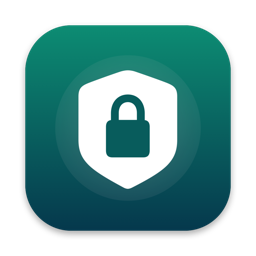

<p align="center"></p>

# AmneziaGuard

**English** · [Русский](README.ru.md)

A kill switch for [AmneziaVPN](https://amnezia.org) on macOS. Traffic is allowed out **only through
the Amnezia tunnel**. Anything that tries to go around it is dropped, and so is everything else when
the VPN is down. A shield in the menu bar shows the status and the live speed through the tunnel.

> Unofficial companion tool. Not affiliated with or endorsed by the Amnezia team.

## Features

- **Strict kill switch built on the macOS packet filter (pf).** Only the Amnezia tunnel interface
  and Amnezia's own encrypted packets to its server can leave the machine. If the VPN drops,
  the internet is closed, not leaked.
- **Blocks only around Amnezia.** Another VPN running at the same time is blocked too.
- **No DNS leaks.** DNS queries to the router are blocked even when local network access is allowed.
- **Fast reaction.** A native watcher listens to kernel network events and wakes the service within
  milliseconds. Every 0.2 s it checks the firewall itself: if something disables pf or removes the
  rules, it puts them back.
- **Fails closed.** If the service crashes, the rules stay loaded.
- **Learns the VPN server by itself.** The server IP is read from the firewall's state table the
  moment Amnezia connects (or, failing that, from its next keepalive packet within 30 s), so
  reconnecting is immediate even while the kill switch is on. It keeps learning while the rule is off.
- **Works alongside Amnezia's own kill switch.** The desktop app has its own pf rules with a list of
  addresses it must reach to reconnect (its server, its API, sites you excluded) and the DNS it uses.
  AmneziaGuard copies those lists, so Amnezia can always reconnect, while everything else stays blocked.
- **Menu bar app.** Green, orange or red shield, live ↓/↑ speed, a 90-second traffic graph,
  the number of blocked packets, and a one-click leak test.
- **Easy to turn off.** A big button to disable the rule, or disable it for 15 minutes and have it
  re-enable itself. No password prompt: see [Password-free buttons](#password-free-buttons).

## Measured reaction times

Measured on a Mac mini (Apple Silicon, macOS 26) with a real Amnezia reconnect:

| Event | Reaction |
|---|---|
| Amnezia disconnects → rules updated, internet closed | 257 ms |
| Amnezia connects → new tunnel allowed | 82 ms |
| Internet works again through the new tunnel | 0.73 s (mostly the VPN handshake) |
| pf disabled or rules removed by another program → restored | 15–180 ms (test bench) |

CPU use at idle is about 1% of one core for the service and about 1% for the watcher.

## Requirements

- macOS 13 or newer
- AmneziaVPN. Tested with both the App Store build (Network Extension) and the desktop build
  (with its own kill switch on), AmneziaWG protocol.
- Xcode Command Line Tools to build (`xcode-select --install`)

## Install

Connect Amnezia first, so the service can learn your server right away. Then:

```bash
git clone https://github.com/Gainslean/amnezia-guard.git
cd amnezia-guard
sudo ./install.sh
```

The installer builds the app, installs the service (LaunchDaemon, starts at boot) and the menu bar
app (LaunchAgent, starts at login). If Amnezia is not connected, it warns you first: the internet
will stay closed until you connect.

## Menu bar

| Icon | Meaning |
|---|---|
| Green shield with a lock, `↓1.3M ↑81K` | All good: traffic goes only through Amnezia |
| Orange crossed-out shield, `нет VPN` | VPN is off, internet is closed, nothing leaks |
| Red shield with `!`, `ВЫКЛ` | The rule is turned off, traffic can bypass the VPN |
| Red shield with `×`, `?` | The service is not responding |

The app's interface is in Russian.

### Password-free buttons

The installer adds `/etc/sudoers.d/amneziaguard`, which lets the user who ran the installer run
exactly three commands as root without a password: `agctl on`, `agctl off` and `agctl off 15`.
Nothing else is allowed. The trade-off: any program running as that user can also turn the kill
switch off. If you prefer a password prompt, delete that file
(`sudo rm /etc/sudoers.d/amneziaguard`) and the buttons fall back to the macOS admin dialog.

This was added because on recent macOS the admin dialog opened from a menu bar app may not accept
keyboard input.

## Command line

```bash
sudo "/Library/Application Support/AmneziaGuard/agctl" off      # turn the rule off
sudo "/Library/Application Support/AmneziaGuard/agctl" off 15   # off for 15 minutes
sudo "/Library/Application Support/AmneziaGuard/agctl" on       # turn it back on
"/Library/Application Support/AmneziaGuard/agctl" status        # current status
sudo bash tools/leakwatch.sh 15   # listen 15 s and list anything leaving outside the VPN
sudo bash tools/pfdiag.sh         # read-only firewall report (all anchors, tables, Amnezia sockets)
```

## Settings

`/Library/Application Support/AmneziaGuard/config` (edit with `sudo`, applied within seconds):

| Setting | Default | Meaning |
|---|---|---|
| `ALLOW_LAN` | `1` | Allow the local network (printer, AirDrop, NAS). DNS to the router stays blocked. `0` closes the LAN too. |
| `ALLOW_SPLIT` | `0` | `1` lets through the addresses that Amnezia itself excludes from the VPN (split tunneling). With `0`, those sites stop working. |
| `AMNEZIA_EXCEPTIONS` | `1` | Copy the addresses and DNS servers that Amnezia's own kill switch allows. Needed for the desktop app to reconnect. `0` allows only the tunnel and the learned server. |
| `EXTRA_ALLOW` | empty | Extra VPN server IPs, space-separated, if a new server was not learned automatically. |
| `PROC_PATTERN` | Amnezia process names | Regex used to find the Amnezia process. |

## How it works

```
apps ──► utunN (Amnezia tunnel) ──► Amnezia encrypts ──► Wi-Fi/Ethernet ──► VPN server
  │                                                         ▲
  └──── any direct connection ──► pf: block drop ✗          │ only Amnezia's own UDP port
                                                              and the learned server IPs pass
```

- **`daemon/guard.sh`** (root) finds the Amnezia process and its tunnel. The tunnel is identified by
  the `utun_control` socket the process holds, so another VPN's `utun` is never trusted. It loads
  the rules into the pf anchor `com.apple/000.AmneziaGuard` and writes `status.json` for the app.
- **`tools/agwatch.swift`** reads the kernel routing socket (interfaces, addresses, routes; it ignores
  the routes cloned for every new website) and checks pf 5 times a second, using `posix_spawn`
  instead of a shell to keep it cheap.
- **`daemon/learn.sh`** learns the server IP from the pf state table and copies Amnezia's own
  exceptions (`amn/110.allowNets` and `amn/310.blockDNS` tables) to disk, so they also work at boot.
- **`daemon/rules.sh`** generates the ruleset: loopback, the Amnezia tunnel, DHCP, Amnezia's UDP port,
  DNS only to Amnezia's DNS servers (all other DNS is dropped), the learned server IPs, Amnezia's
  exceptions, optionally the LAN, then `block drop quick all`.
- **`app/`** is the menu bar app in Swift/AppKit. Speeds come from 64-bit interface counters
  (`NET_RT_IFLIST2`). The leak test tries a TCP connection to 1.1.1.1 bound to the physical
  interface, the way a leaking app would, and expects it to fail.

## Limitations

- There is a short window at boot before the service starts and loads the rules. `/etc/pf.conf` is
  left untouched on purpose.
- If something disables pf, there is a window of up to about 0.2 s before it is turned back on.
- A new server is usually learned within a second. If it still is not, add it with `EXTRA_ALLOW` or
  turn the rule off for 15 minutes once.

## Uninstall

```bash
sudo ./uninstall.sh
```

Removes the rules, the service, the app and the settings.

## License

[MIT](LICENSE)
